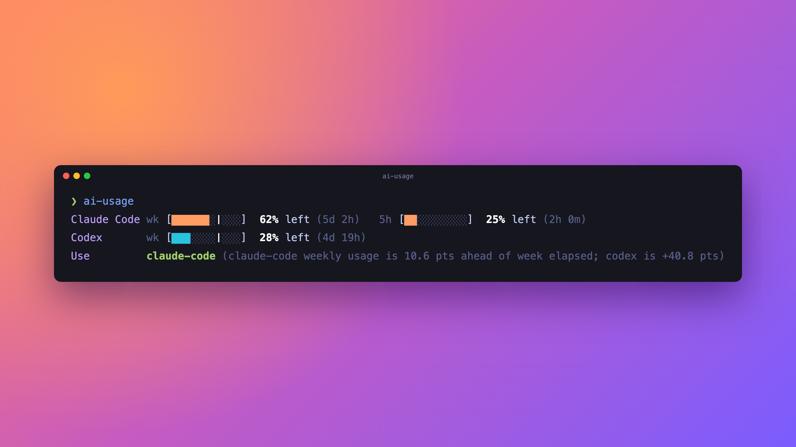

# ai-usage

A small CLI that prints how much of your Claude Code and Codex plan usage is left.



```
Claude Code wk [██████░│░░░]  63% left (5d 2h)   5h [███░░░░░░░]  34% left (2h 27m)
Codex       wk [███░░░░│░░░]  29% left (4d 20h)
Use         claude-code (claude-code weekly usage is 9.9 pts ahead of week elapsed; codex is +40.1 pts)
```

- Filled blocks show usage left, matching the `% left` number. Light blocks show usage spent.
- `│` on a weekly bar marks how much of the week is left. Filled blocks ending before the marker mean you are using quota faster than an even pace.
- Each tool shows its weekly window, and its 5-hour window when the plan has one.
- Output is coloured on a terminal. Set `NO_COLOR=1` to turn colour off. Piped output and `--agent` are never coloured.
- `Use` names the recommended harness, picked by the same rule as `--agent` (see below).

## Requirements

- macOS (Claude Code stores its login in the macOS keychain).
- Python 3.9 or newer. No other dependencies.
- You are logged in to Claude Code (`claude`) and Codex (`codex login`) with a subscription plan.

## Install

```sh
curl -o ~/.local/bin/ai-usage https://raw.githubusercontent.com/nazreen/ai-usage/main/ai-usage
chmod +x ~/.local/bin/ai-usage
```

Make sure `~/.local/bin` is on your `PATH`.

## Usage

```sh
ai-usage           # one line per tool, with bars
ai-usage --agent   # JSON for agents choosing a harness
ai-usage --help    # what the tool does
```

### `--agent`

Prints JSON with `recommended_harness`, a `reason`, the `rule` used, and the raw numbers for each window.

The recommended harness is the one with the lowest weekly `pace_delta_pct` (weekly % used minus % of the week elapsed). A harness is skipped if it has 0% weekly quota left, or under 10% of its 5-hour quota left. `reason` names each skipped harness and why. A harness whose usage could not be fetched is listed in `unavailable_harnesses` and named in `reason`. If no harness has usable data, `recommended_harness` is `null`.

`wait_option` is set when a harness was skipped only for its 5-hour window, that window resets within 60 minutes, and its weekly pace is better than the recommended harness (or there is none). It gives `harness`, `resets_in_minutes` and `pace_delta_pct`. Otherwise it is `null`. The default output adds the same advice to `Use`, for example `or wait 0h 53m for claude-code (weekly pace +5.4 pts)`.

An agent rule might say: "Before picking a harness, run `ai-usage --agent` and use `recommended_harness`."

## How it works

It calls the same endpoints the official clients use:

- Claude Code: `GET https://api.anthropic.com/api/oauth/usage`, with the OAuth token read from the keychain item `Claude Code-credentials`.
- Codex: `GET https://chatgpt.com/backend-api/wham/usage`, with the token read from `~/.codex/auth.json`.

Tokens are read at run time and sent only to those two hosts. They are never written to disk.

Each API response is cached for 60 seconds in `~/.cache/ai-usage/` (or `$XDG_CACHE_HOME/ai-usage/`), with file mode `600`, so repeated runs don't hit rate limits. Failed requests are not cached.

These endpoints are not documented public APIs. They can change or break without notice.

## License

MIT
